# ZenClass

Nền tảng quản lý trung tâm đào tạo (ngoại ngữ, dạy thêm, năng khiếu) trên web và điện thoại. Một hệ thống cho cả trung tâm lẫn học viên và phụ huynh: xếp lịch, điểm danh, thu học phí, tính lương, báo cáo.

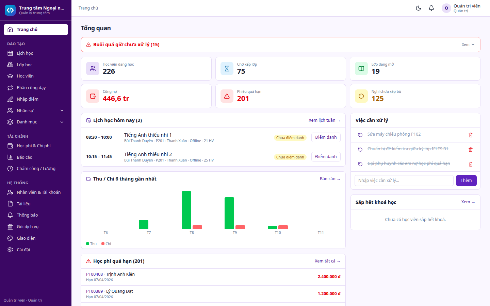

## Tính năng chính

### Đào tạo

**Lịch học** hiển thị theo tuần, theo phòng và theo giáo viên. Hệ thống tự sinh buổi học từ lịch của lớp, tránh trùng phòng và trùng giáo viên, và bỏ qua ngày nghỉ lễ.

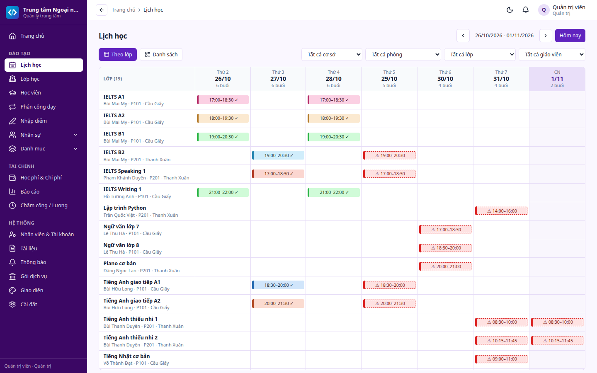

**Lớp học** quản lý danh sách học viên, giáo viên chính, lịch hằng tuần, học phí và bộ điểm của từng lớp.

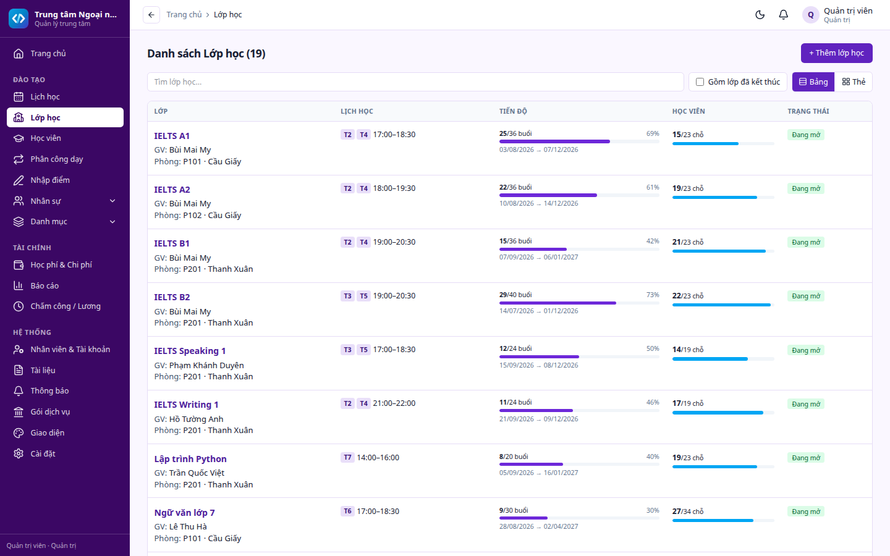

**Học viên** lọc theo trạng thái: đang học, chờ xếp lớp, nghỉ chưa xếp bù, sắp hết khoá, khoá, nghỉ học. Hỗ trợ tìm kiếm, xuất Excel (CSV) và nhập hàng loạt.

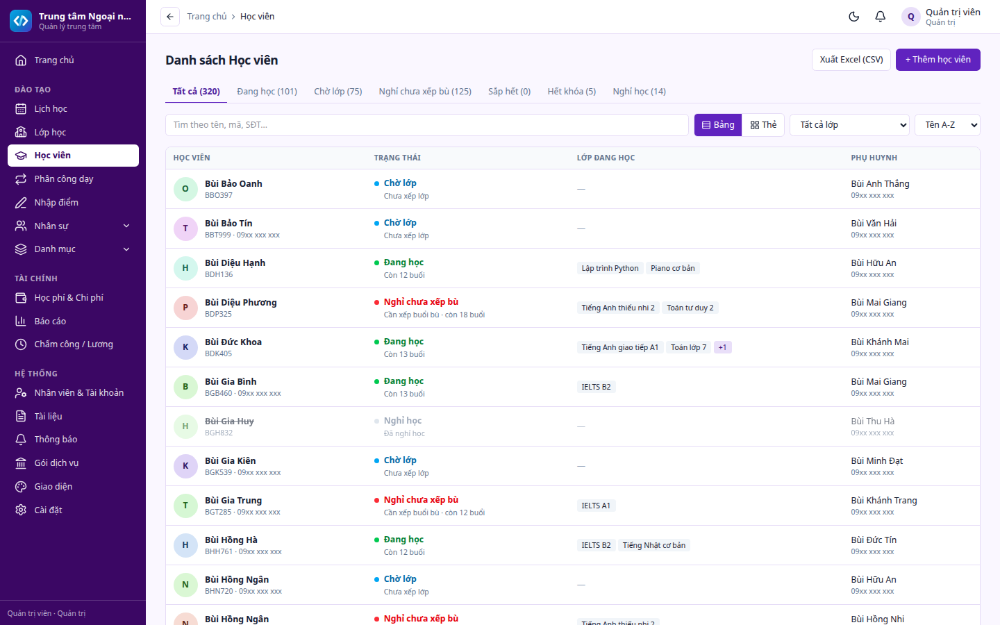

Hồ sơ từng học viên gom lớp đang học, số buổi còn lại, chuyên cần, bảng điểm, nhận xét và công nợ. Có nút tải lịch học dạng PDF.

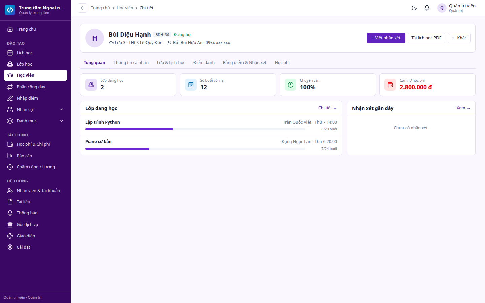

**Nhập điểm** theo bộ điểm tự cấu hình (cột điểm, trọng số, thang điểm, xếp loại).

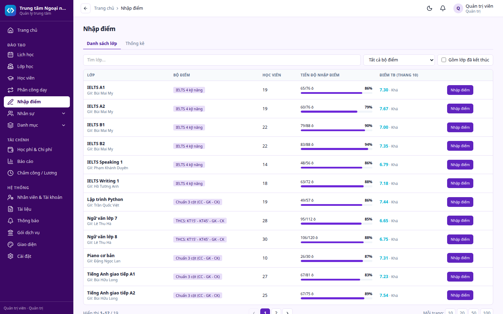

### Tài chính

**Học phí và chi phí**: phiếu học phí, ghi nhận thu tiền (một phần hoặc đủ), theo dõi công nợ và phiếu quá hạn.

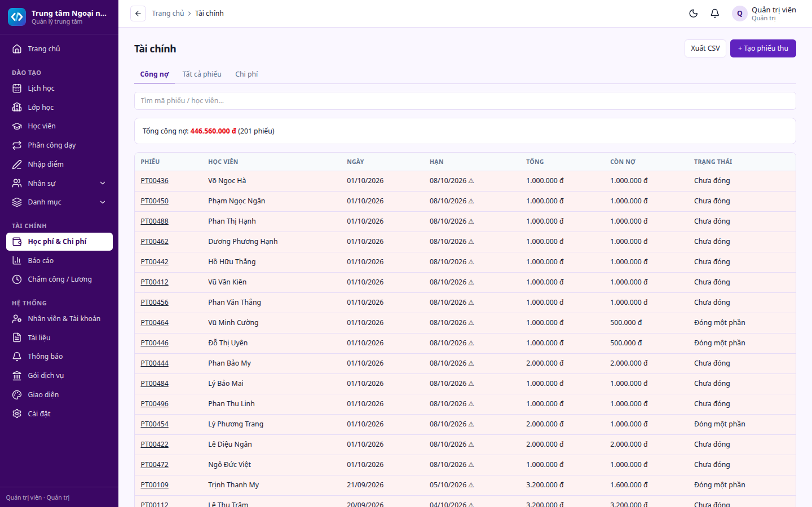

Mỗi phiếu học phí có mã QR VietQR. Nếu trung tâm bật **PayOS**, phiếu có nút "Thanh toán ngay" và hệ thống tự gạch nợ khi nhận được tiền. Học viên và phụ huynh cũng xem được phiếu của mình.

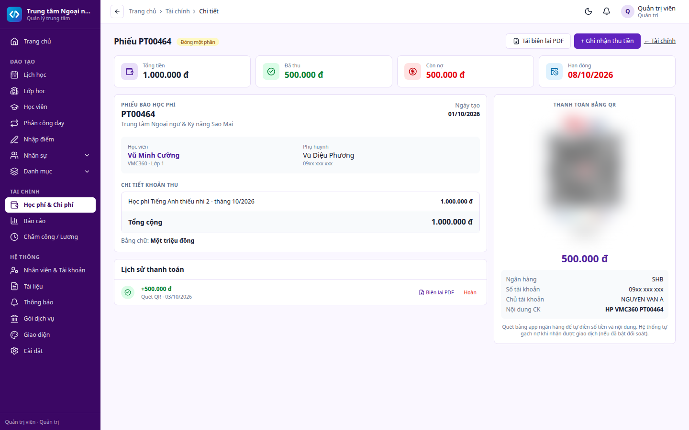

**Biên lai PDF**: sau khi có khoản thu, cả trung tâm, học viên và phụ huynh đều tải được biên lai ở dạng PDF chuẩn (font nhúng đủ dấu tiếng Việt), kể cả biên lai riêng cho từng lần nộp. Hệ thống không in bằng HTML.

| Biên lai thu tiền học phí | Lịch học của học viên |
|---|---|
| 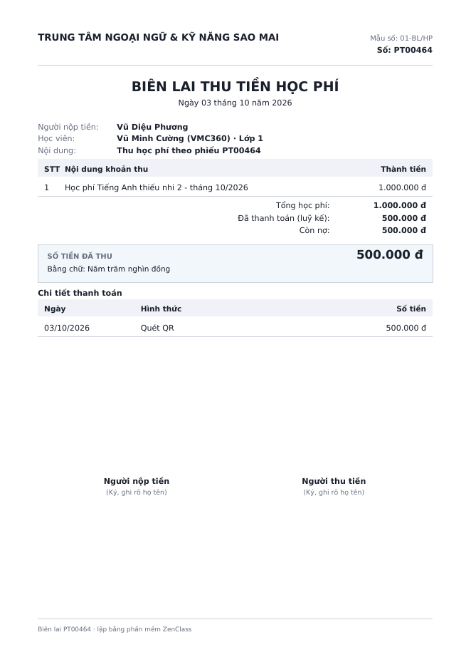 | 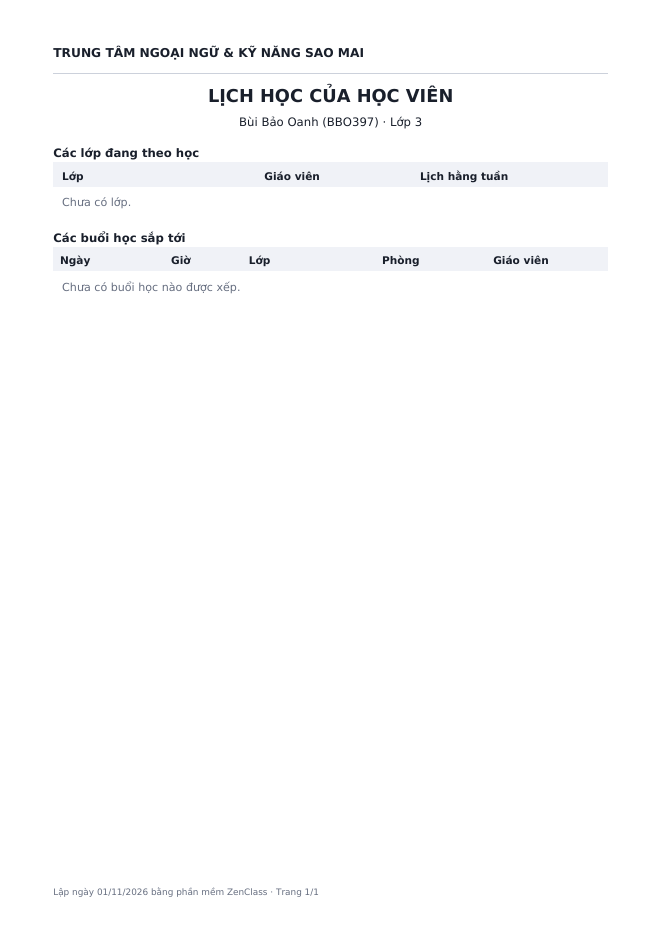 |

> Biên lai này do hệ thống tự lập để xác nhận khoản đã thu. Nó chưa phải hoá đơn điện tử theo Nghị định 123/2020. Muốn xuất hoá đơn VAT chính thức cần tích hợp thêm nhà cung cấp hoá đơn điện tử.

**Chấm công và lương** cho giáo viên, trợ giảng và nhân viên.

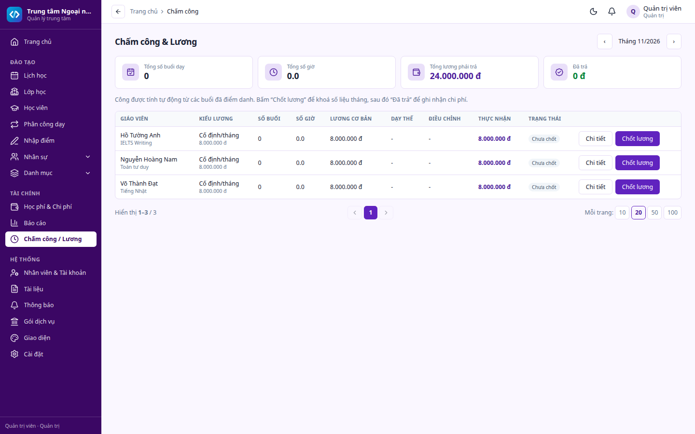

**Báo cáo** thu chi, doanh thu và tình hình học viên.

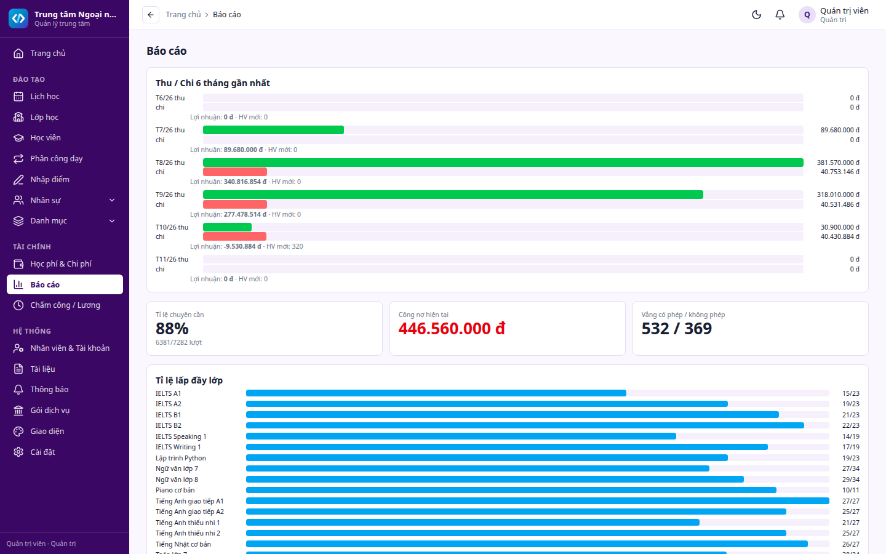

### Hệ thống

- **Phân quyền** theo vai trò: quản trị, nhân viên (cấp quyền chi tiết), giáo viên, trợ giảng, học viên, phụ huynh. Xem [docs/PHAN_QUYEN.md](docs/PHAN_QUYEN.md).
- **Nhiều trung tâm** trên cùng một hệ thống, dữ liệu tách riêng bằng row-level security của PostgreSQL. **Gói dịch vụ** theo hạn mức. Xem [docs/SAAS.md](docs/SAAS.md).
- **Giao diện** đổi được màu, font, độ bo góc và chế độ tối cho từng trung tâm.
- **Thông báo** trong ứng dụng và Web Push; nhắc lịch học và học phí tự động.
- **Cổng học viên và phụ huynh**: xem lịch, điểm danh, bảng điểm, học phí. Dùng tốt trên điện thoại.

| Đăng nhập | Giao diện | Gói dịch vụ |
|---|---|---|
| 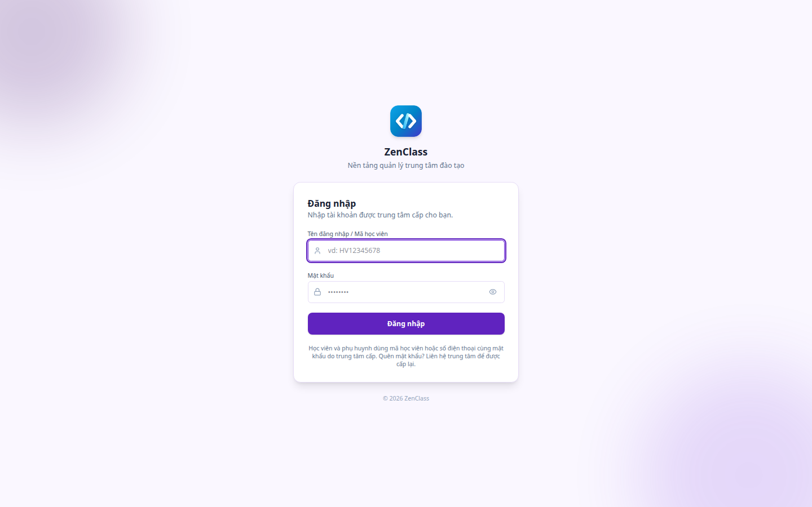 | 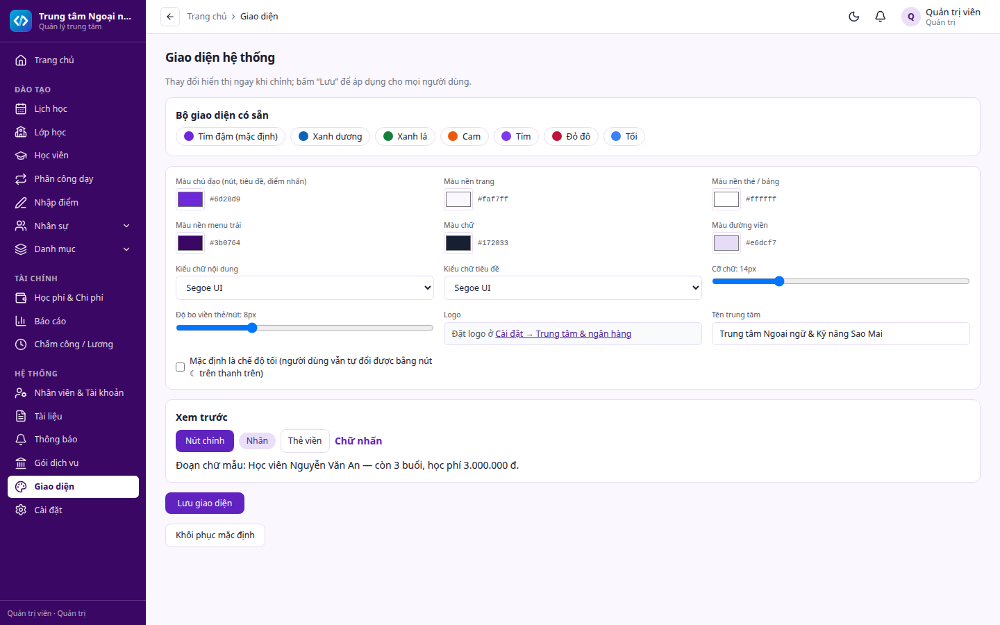 | 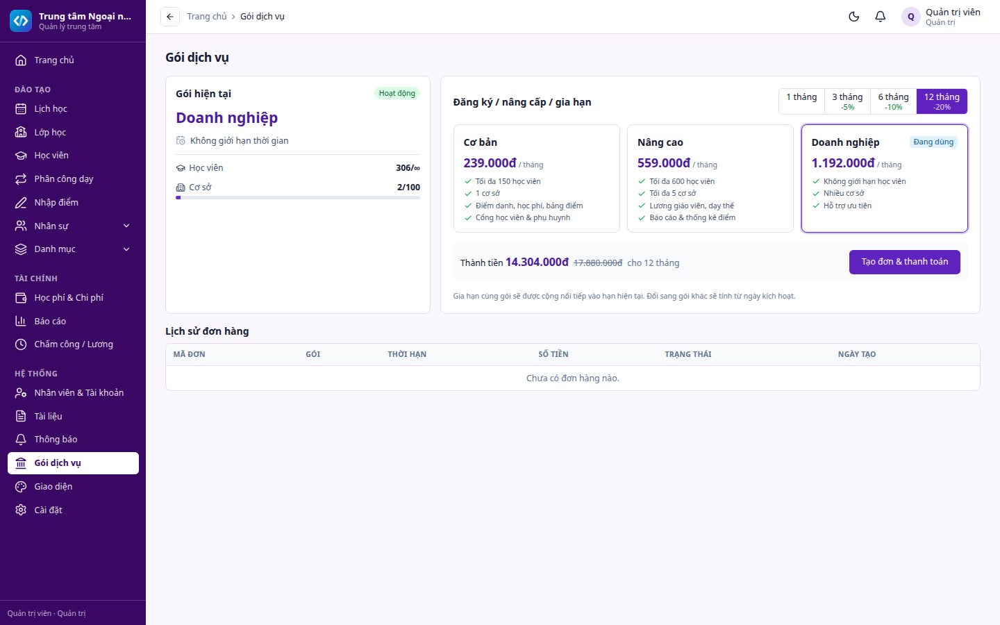 |

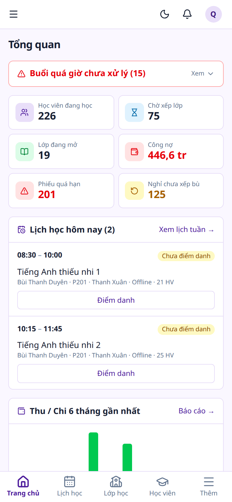

## Công nghệ

Next.js 15 (App Router) · React 19 · TypeScript · Tailwind CSS 4 · PostgreSQL · Prisma · NextAuth · PayOS · VietQR · pdf-lib · Web Push. Triển khai trên Vercel.

Thiết kế chi tiết nằm ở [docs/THIET_KE_HE_THONG.md](docs/THIET_KE_HE_THONG.md).

## Chạy trên máy

Cần Node.js 20+ và một cơ sở dữ liệu PostgreSQL.

```bash
npm install
cp .env.product .env                      # rồi điền giá trị thật, xem bảng biến môi trường bên dưới
npx prisma db push                        # tạo bảng (dùng DIRECT_URL, tức role chủ bảng)
psql -f prisma/saas/00-roles.sql          # tạo role app_rw, rồi trỏ DATABASE_URL tới role này
psql -f prisma/saas/02-rls.sql            # bật row-level security (chạy lại sau mỗi lần thêm bảng)
SUPERADMIN_PASSWORD='...' npx tsx prisma/saas/create-superadmin.ts
npm run dev                               # http://localhost:3000
```

Đăng nhập bằng tài khoản superadmin, vào `/platform` để tạo trung tâm đầu tiên. Chi tiết các bước ở [docs/SAAS.md](docs/SAAS.md).

Dữ liệu mẫu để thử: `npx tsx prisma/seed-demo.ts`. Lệnh này **xoá dữ liệu hiện có** trừ tài khoản admin, nên đừng chạy trên dữ liệu thật.

### Biến môi trường

| Biến | Ý nghĩa |
|---|---|
| `DATABASE_URL`, `DIRECT_URL` | Kết nối PostgreSQL (qua pooler và trực tiếp) |
| `NEXTAUTH_SECRET`, `NEXTAUTH_URL` | Khoá và địa chỉ cho đăng nhập |
| `APP_URL` | Địa chỉ công khai, dùng cho PayOS (`returnUrl`, `cancelUrl`, webhook) |
| `SECRETS_KEY` | Khoá mã hoá các khoá PayOS của từng trung tâm (bỏ trống thì dùng `NEXTAUTH_SECRET`) |
| `CRON_SECRET` | Bảo vệ các route chạy định kỳ (nhắc lịch, nhắc học phí) |
| `SEPAY_API_KEY` | Đối soát chuyển khoản ngân hàng (tuỳ chọn) |
| `PAYOS_CLIENT_ID`, `PAYOS_API_KEY`, `PAYOS_CHECKSUM_KEY` | Kênh PayOS của nền tảng (tuỳ chọn) |

Mỗi trung tâm có thể khai báo kênh PayOS riêng ở **Cài đặt → Thanh toán PayOS**, tiền học phí về thẳng tài khoản của trung tâm.

## Triển khai

```bash
vercel --prod
```

Sau khi đổi tên miền, cập nhật `APP_URL` rồi bấm "Đăng ký webhook với PayOS" ở trang Cài đặt để PayOS gọi về đúng địa chỉ mới.

## Chụp lại ảnh minh hoạ

Ảnh trong [docs/screenshots/](docs/screenshots/) chụp bằng Playwright từ dữ liệu demo. Khi giao diện đổi nhiều, chụp lại để README không lỗi thời. Trước khi đưa ảnh vào repo, hãy che số điện thoại, số tài khoản ngân hàng và mã QR thanh toán.
